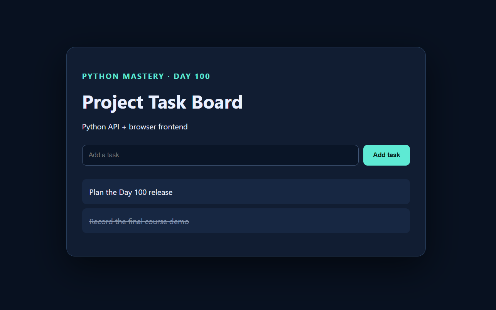

# 🚀 Day 100 - Full-Stack Web Application

Welcome to **Day 100** of my **100 Days, 100 Python Projects** challenge!

This project is a **Full-Stack Task Management Web Application** built using Python, HTML, CSS, and JavaScript. It demonstrates how a Python backend can communicate with a browser-based frontend through REST-style API endpoints to manage tasks.

The application uses Python's built-in HTTP server, object-oriented programming, dataclasses, JSON serialization, and JavaScript's Fetch API to create a functional task board. Users can view existing tasks, add new tasks, and toggle their completion status through a web interface.

The project includes a dark-themed responsive task board, a Python backend for task management, and a lightweight API that processes requests from the frontend.

**Note:** This project uses a custom Python HTTP server built with the standard library. It does not use Flask, Django, React, or an external database.

---

## 📌 Project Overview

A task management application helps users organize their work, track activities, and mark tasks as completed.

This project connects a browser-based frontend with a Python backend. The frontend sends HTTP requests to the backend, which processes task operations and returns JSON responses.

The application follows this workflow:

- 🌐 Serve the task board in a web browser.
- 📋 Display existing tasks from the backend.
- ➕ Create new tasks through an HTML form.
- 🔄 Toggle task completion by clicking a task.
- 🔌 Communicate with the backend through HTTP endpoints.
- 📦 Exchange task data in JSON format.
- ⚠️ Validate task titles on the server.
- 🧪 Run a backend integration check using the `--check` option.
- 🎨 Present tasks in a dark-themed interface.
- 🐍 Use Python's built-in HTTP server without external dependencies.

The application runs locally on your computer and demonstrates the connection between frontend and backend components.

---

## ✨ Features

- 🌐 Full-stack web application
- 🐍 Python HTTP server
- 📋 Task listing
- ➕ Create new tasks
- ✅ Toggle task completion status
- 🔌 REST-style API endpoints
- 📦 JSON request and response handling
- 🧩 Task dataclass and object-oriented design
- ⚠️ Empty task-title validation
- 🔢 Automatic task ID generation
- 🎨 Dark-themed frontend
- 📱 Responsive page layout
- ⚡ JavaScript Fetch API integration
- 🧪 Command-line integration check
- 🧵 Multithreaded HTTP request handling
- 📁 Static file serving
- 📦 No external Python dependencies

---

## 🏗️ Application Architecture

The project follows a simple full-stack architecture consisting of a browser frontend, a Python HTTP server, and an in-memory task store.

```text
          Web Browser
               |
               v
     HTML + CSS + JavaScript
               |
               v
         JavaScript Fetch
               |
               v
       Python HTTP Server
       ThreadingHTTPServer
               |
               v
           AppHandler
               |
         +-----+------+
         |            |
         v            v
      GET/POST      PATCH
      /api/tasks    /api/tasks/{id}
         |            |
         +-----+------+
               |
               v
           TaskStore
               |
               v
           Task Model
               |
               v
        JSON API Response
               |
               v
        Update Task Board
```

### Module Responsibilities

- **`main100.py`** — starts the HTTP server, handles API requests, serves static files, and provides the integration-check mode.
- **`store.py`** — defines the `Task` dataclass and `TaskStore` class for storing, creating, listing, and updating tasks.
- **`static/index.html`** — provides the webpage structure and task input form.
- **`static/styles.css`** — defines the application's colors, layout, form styling, and completed-task appearance.
- **`static/app.js`** — fetches tasks, creates new tasks, and sends completion-toggle requests.
- **`screenshots/task-board.png`** — screenshot of the main task board, if included in the repository.

---

## 🐍 Python Backend

The backend is implemented in `main100.py` using Python's built-in HTTP server modules.

```python
import argparse
import json
from http.server import (
    SimpleHTTPRequestHandler,
    ThreadingHTTPServer
)
from pathlib import Path

from store import TaskStore
```

### Technologies Used in the Backend

| Component | Purpose |
|---|---|
| `argparse` | Handles command-line options such as `--check` and `--port` |
| `json` | Serializes API responses and parses request bodies |
| `SimpleHTTPRequestHandler` | Serves static files and provides HTTP request handling |
| `ThreadingHTTPServer` | Handles HTTP requests using separate threads |
| `Path` | Resolves the static directory relative to the Python file |
| `TaskStore` | Manages task data and task operations |

### Static File Configuration

```python
STORE = TaskStore()
STATIC = Path(__file__).parent / "static"
```

The `STORE` variable creates the task store used by the server.

The `STATIC` path points to the `static` directory beside `main100.py`. This directory contains the HTML, CSS, and JavaScript files.

The application passes this directory to `SimpleHTTPRequestHandler`, allowing the server to serve the frontend files.

### Custom Request Handler

The `AppHandler` class extends `SimpleHTTPRequestHandler`.

```python
class AppHandler(SimpleHTTPRequestHandler):
    def __init__(self, *args, **kwargs):
        super().__init__(
            *args,
            directory=str(STATIC),
            **kwargs
        )
```

The custom handler serves static files from the project's `static` folder while implementing additional API endpoints.

The backend supports three main operations:

- `GET /api/tasks` — retrieve all tasks.
- `POST /api/tasks` — create a new task.
- `PATCH /api/tasks/{id}` — toggle the completion status of a task.

---

## 🔌 API Endpoints

The application uses HTTP endpoints to connect the frontend to the Python backend.

### 1. Get All Tasks

**Endpoint:** `GET /api/tasks`

This endpoint returns all tasks stored in the `TaskStore`.

```python
def do_GET(self):
    if self.path == "/api/tasks":
        return self.send_json(
            200,
            {"tasks": STORE.list()}
        )

    return super().do_GET()
```

The response contains a `tasks` array with each task's ID, title, and completion status.

Example response:

```json
{
  "tasks": [
    {
      "id": 1,
      "title": "Plan the Day 100 release",
      "completed": false
    },
    {
      "id": 2,
      "title": "Record the final course demo",
      "completed": true
    }
  ]
}
```

The initial task data comes from the `TaskStore` constructor.

### 2. Create a Task

**Endpoint:** `POST /api/tasks`

The frontend sends a JSON object containing a task title.

Example request body:

```json
{
  "title": "Complete project documentation"
}
```

The backend reads the request body, extracts the title, and passes it to `STORE.create()`.

```python
if self.path == "/api/tasks":
    data = self.read_json()

    return self.send_json(
        201,
        STORE.create(data.get("title", ""))
    )
```

If the title is valid, the backend creates a task and returns the new task object with HTTP status `201 Created`.

Example response:

```json
{
  "id": 3,
  "title": "Complete project documentation",
  "completed": false
}
```

The exact ID depends on the current tasks in the store.

If the title is empty or contains only whitespace, the backend returns a `400 Bad Request` response with an error message.

### 3. Toggle Task Completion

**Endpoint:** `PATCH /api/tasks/{id}`

This endpoint changes a task's completion status.

For example:

```text
PATCH /api/tasks/1
```

The backend extracts the task ID from the URL and calls `STORE.toggle()`.

```python
if self.path.startswith("/api/tasks/"):
    task_id = int(
        self.path.rsplit("/", 1)[-1]
    )

    return self.send_json(
        200,
        STORE.toggle(task_id)
    )
```

If the task exists, its `completed` property is inverted.

For example, an incomplete task becomes complete:

```json
{
  "id": 1,
  "title": "Plan the Day 100 release",
  "completed": true
}
```

Clicking the task again changes `completed` back to `false`.

If the task ID is invalid or the task does not exist, the current handler returns a `404 Not Found` response.

**Important:** This endpoint toggles the completion status; it does not accept an explicit `completed` value from the client.

---

## 📦 JSON Request and Response Handling

The backend defines two helper methods for JSON communication.

### Sending JSON

```python
def send_json(self, status, data):
    body = json.dumps(data).encode()

    self.send_response(status)
    self.send_header(
        "Content-Type",
        "application/json"
    )
    self.send_header(
        "Content-Length",
        str(len(body))
    )
    self.end_headers()
    self.wfile.write(body)
```

This method:

1. Converts Python data into a JSON string.
2. Encodes the string into bytes.
3. Sends the HTTP status code.
4. Sets the response content type.
5. Sets the content length.
6. Writes the response body.

### Reading JSON

```python
def read_json(self):
    length = int(
        self.headers.get("Content-Length", 0)
    )

    return json.loads(
        self.rfile.read(length) or b"{}"
    )
```

This method reads the number of bytes specified by the request's `Content-Length` header and parses the body as JSON.

If the body is empty, it attempts to parse an empty JSON object.

**Current limitation:** Malformed JSON and some invalid request-body formats can raise exceptions that are not explicitly handled by the current implementation. The code also does not impose a maximum request-body size.

---

## 🗂️ Task Data Model

The `store.py` module defines the `Task` dataclass.

```python
from dataclasses import asdict, dataclass

@dataclass
class Task:
    id: int
    title: str
    completed: bool = False

    def to_dict(self):
        return asdict(self)
```

### Task Attributes

| Attribute | Description |
|---|---|
| `id` | Unique sequential task identifier |
| `title` | Text describing the task |
| `completed` | Boolean indicating whether the task is complete |

The `completed` field defaults to `False`, so newly created tasks begin as incomplete.

The `to_dict()` method uses `asdict()` to convert the task object into a dictionary suitable for JSON serialization.

### Example Task

```python
Task(
    id=1,
    title="Plan the Day 100 release",
    completed=False
)
```

This represents an incomplete task with ID `1`.

---

## 🧠 TaskStore Class

The `TaskStore` class manages task records in memory.

### Initial Tasks

When the application starts, the store initializes two tasks:

```python
self.tasks = {
    1: Task(
        1,
        "Plan the Day 100 release"
    ),
    2: Task(
        2,
        "Record the final course demo",
        True
    )
}
```

| ID | Task Title | Initial Status |
|---:|---|---|
| 1 | Plan the Day 100 release | Incomplete |
| 2 | Record the final course demo | Completed |

These predefined tasks allow the task board to display useful sample data immediately.

### Listing Tasks

```python
def list(self):
    return [
        task.to_dict()
        for task in self.tasks.values()
    ]
```

The `list()` method converts each task into a dictionary and returns the results in a list.

### Creating Tasks

```python
def create(self, title):
    if not title.strip():
        raise ValueError(
            "Task title is required"
        )

    task = Task(
        max(self.tasks, default=0) + 1,
        title.strip()
    )

    self.tasks[task.id] = task
    return task.to_dict()
```

The method:

1. Checks whether the title contains non-whitespace characters.
2. Removes leading and trailing whitespace.
3. Generates the next task ID.
4. Creates a new `Task` object.
5. Stores it in the dictionary.
6. Returns the task as a dictionary.

The ID is generated using:

```python
max(self.tasks, default=0) + 1
```

This produces the next ID after the highest existing key.

### Toggling Completion

```python
def toggle(self, task_id):
    task = self.tasks.get(task_id)

    if not task:
        raise LookupError("Task not found")

    task.completed = not task.completed
    return task.to_dict()
```

The method retrieves the task using its ID.

If no task exists, it raises a `LookupError`. Otherwise, it changes the completion state and returns the updated task.

**Note:** All task records exist only in memory. Restarting the application resets the store to the two initial tasks.

---

## 🎨 Frontend Design

The frontend is built using HTML, CSS, and JavaScript in the `static` directory.

### HTML — `static/index.html`

The HTML file defines the task board's structure.

Its main elements include:

- Page title: `Day 100 Task Board`
- Heading: `Project Task Board`
- Short description: `Python API + browser frontend`
- Form for entering a new task
- Input field for the task title
- Add task button
- Unordered list for displaying tasks
- JavaScript file reference

The form uses the ID `task-form`, the input uses `title`, and the task list uses `tasks`. These IDs allow JavaScript to locate and update the relevant elements.

### CSS — `static/styles.css`

The stylesheet creates a dark-themed interface.

Key styling features include:

- Dark navy background
- Centered task board
- Rounded corners
- Border and shadow effects
- Teal accent color
- Styled task input and button
- Custom task list items
- Strikethrough formatting for completed tasks
- Flexible form layout

The `main` container uses a responsive width:

```css
main {
    width: min(680px, 88vw);
}
```

This limits the content width to 680 pixels or 88% of the viewport width, whichever is smaller.

Completed tasks use the `.done` class:

```css
.done {
    color: #8191aa;
    text-decoration: line-through;
}
```

The JavaScript assigns this class when a task's `completed` property is `true`.

### JavaScript — `static/app.js`

The JavaScript file connects the browser interface to the backend.

It selects the task list and form:

```javascript
const list = document.querySelector("#tasks");
const form = document.querySelector("#task-form");
```

The main functions are:

- `load()` — retrieves and displays tasks.
- `form.onsubmit` — sends a request to create a task.
- `item.onclick` — sends a request to toggle task completion.

---

## 🔄 Frontend and Backend Integration

### Loading Tasks

The `load()` function retrieves tasks from the API.

```javascript
async function load() {
    const response = await fetch("/api/tasks");
    const data = await response.json();

    list.innerHTML = "";

    data.tasks.forEach((task) => {
        const item = document.createElement("li");

        item.className = task.completed ? "done" : "";
        item.textContent = task.title;

        item.onclick = async () => {
            await fetch(
                `/api/tasks/${task.id}`,
                { method: "PATCH" }
            );

            load();
        };

        list.appendChild(item);
    });
}
```

The function:

1. Sends a `GET` request to `/api/tasks`.
2. Parses the JSON response.
3. Clears the current task list.
4. Creates a list item for each task.
5. Applies the `done` class when a task is completed.
6. Adds a click handler to each task.
7. Appends each task to the webpage.

After a task is clicked, the browser sends a `PATCH` request and reloads the task list.

### Adding a Task

The form submission handler prevents the browser's default form submission behavior.

```javascript
form.onsubmit = async (event) => {
    event.preventDefault();

    const title = document.querySelector("#title");

    await fetch("/api/tasks", {
        method: "POST",
        headers: {
            "Content-Type": "application/json"
        },
        body: JSON.stringify({
            title: title.value
        })
    });

    title.value = "";
    load();
};
```

The handler:

1. Prevents a full-page form submission.
2. Reads the task title.
3. Sends a `POST` request containing JSON.
4. Clears the input field.
5. Reloads the task list.

**Current limitation:** The frontend does not inspect the response status before clearing the input and refreshing the task list. If task creation fails, the user does not receive a dedicated error message.

---

## 🧪 Backend Integration Check

The `main100.py` file includes a `check()` function that verifies basic task-store operations.

```python
def check():
    created = STORE.create(
        "Verify frontend and backend integration"
    )

    toggled = STORE.toggle(created["id"])

    result = {
        "status": "ok",
        "task_count": len(STORE.list()),
        "created_and_toggled": toggled
    }

    print(json.dumps(result, indent=2))
```

The check performs the following operations:

1. Creates a test task.
2. Toggles the new task's completion status.
3. Counts the tasks in the store.
4. Displays a JSON summary.

Run the check with:

```bash
python main100.py --check
```

Expected output structure:

```json
{
  "status": "ok",
  "task_count": 3,
  "created_and_toggled": {
    "id": 3,
    "title": "Verify frontend and backend integration",
    "completed": true
  }
}
```

The task count is three because the store begins with two tasks and the check creates one additional task.

The `--check` option does not start the web server. It tests basic store operations in the current process; it does not launch a browser or perform an end-to-end HTTP test of the frontend.

---

## ▶️ Running the Web Application

The application supports a configurable port. By default, it uses port `8000`.

### Step 1 — Install Python

Ensure Python is installed.

```bash
python --version
```

### Step 2 — Open the Project Directory

Open a terminal in the `DAY_100` folder.

```bash
cd DAY_100
```

### Step 3 — Check the Project Structure

Ensure the project contains:

```text
main100.py
store.py
static/
    index.html
    styles.css
    app.js
```

### Step 4 — Run the Application

Execute:

```bash
python main100.py
```

The terminal displays:

```text
Day 100 app running at http://localhost:8000
```

### Step 5 — Open the Task Board

Open the following URL in your browser:

[http://localhost:8000](http://localhost:8000)

The browser should display the Project Task Board with the two initial tasks.

### Step 6 — Add a Task

1. Enter a task title in the input field.
2. Click **Add task**.
3. The browser sends a `POST` request to the backend.
4. The new task appears in the task list.

### Step 7 — Toggle Completion

Click any task in the list.

The application sends a `PATCH` request to the backend. The task's completion status changes, and the page reloads the task list to display the updated state.

### Step 8 — Stop the Server

When finished, return to the terminal and press:

```text
Ctrl + C
```

This stops the local HTTP server.

---

## 📸 Screenshots

### Main Task Board



The screenshot demonstrates the browser-based task board and its dark-themed interface.

---

## 🛠️ Technologies Used

### 🐍 Python

Implements the HTTP server, task management, JSON communication, validation, and command-line options.

### 🌐 HTML5

Defines the webpage structure, task form, heading, and task list.

### 🎨 CSS3

Provides the dark theme, layout, styling, and completed-task appearance.

### ⚡ JavaScript

Handles browser interactions and API communication using asynchronous functions.

### 🔌 HTTP

Uses `GET`, `POST`, and `PATCH` requests to retrieve tasks, create tasks, and toggle completion.

### 📦 JSON

Transfers task information between the frontend and backend.

### 🧵 ThreadingHTTPServer

Handles multiple incoming HTTP requests using separate threads.

### 🗂️ Dataclasses

Provides a structured representation of each task.

### 🧪 Argparse

Supports command-line options for integration checks and port configuration.

---

## 📦 Requirements

This project uses Python's standard library and does not require external Python packages.

### Python Version

Python 3.7 or later supports the dataclasses and other language features used in the project.

### `requirements.txt`

```text
# No external dependencies required.
```

A modern web browser is required to access the frontend.

---

## 📂 Project Structure

```text
DAY_100/
│
├── main100.py
├── store.py
├── requirements.txt
├── README.md
│
├── static/
│   ├── index.html
│   ├── styles.css
│   └── app.js
│
└── screenshots/
    └── task-board.png
```

### File Description

| File / Folder | Purpose |
|---|---|
| `main100.py` | HTTP server, API endpoints, static serving, and integration check |
| `store.py` | Task model and in-memory task store |
| `requirements.txt` | Documents Python dependency requirements |
| `static/index.html` | Frontend page structure |
| `static/styles.css` | Frontend styling |
| `static/app.js` | Task loading, creation, and completion interactions |
| `screenshots/task-board.png` | Main task board screenshot |
| `README.md` | Project documentation |

---

## ⚠️ Important Notes and Limitations

### 1. In-Memory Storage

Tasks are stored in a Python dictionary. Changes are lost when the server stops or restarts.

### 2. Local Development Server

The server binds to `localhost`, making it intended for local use rather than direct public deployment.

### 3. No Authentication

Anyone with access to the running local application can use its task endpoints. There is no login or user-specific task separation.

### 4. No Database

The application does not use SQLite, PostgreSQL, or another persistent database.

### 5. Limited Error Feedback

The backend returns error responses for invalid task titles and missing tasks, but the frontend does not currently display these errors to the user.

### 6. Limited Request Validation

The server does not fully validate malformed JSON, invalid content types, oversized request bodies, or every possible malformed URL.

### 7. No Task Editing or Deletion

Users can create tasks and toggle completion status, but they cannot rename or delete tasks.

### 8. No Search or Filtering

The application does not currently filter tasks by status or search by title.

### 9. Basic Integration Check

The `--check` mode verifies task creation and completion toggling within the task store. It does not verify HTTP requests, frontend behavior, or browser rendering.

### 10. Limited Security Hardening

The project is a learning example, not a production-hardened web service. Authentication, authorization, request validation, and other security controls would be needed before deployment in a shared environment.

---

## 🧠 Concepts Practiced

This project provides practical experience with:

- Full-stack application architecture
- Python HTTP server development
- HTTP request methods
- REST-style API design
- JSON serialization and parsing
- Dataclasses
- Object-oriented programming
- Dictionary-based data storage
- CRUD-related operations
- Input validation
- Exception handling
- Static file serving
- HTML forms
- CSS styling
- JavaScript DOM manipulation
- JavaScript Fetch API
- Asynchronous programming with `async` and `await`
- Frontend-backend integration
- Command-line argument parsing
- Multithreaded HTTP request handling
- Local application testing
- Project organization and documentation

---

## 🎯 Learning Outcomes

By building this project, I practiced how to:

- Build a local web application using Python.
- Serve HTML, CSS, and JavaScript files through an HTTP server.
- Create API endpoints for task management.
- Read JSON request bodies and send JSON responses.
- Design a task model using a dataclass.
- Store and manage tasks using a Python dictionary.
- Generate sequential task IDs.
- Validate task titles.
- Toggle task completion status.
- Connect a browser frontend to a Python backend.
- Use the Fetch API to make asynchronous HTTP requests.
- Update webpage elements using JavaScript.
- Handle basic backend errors.
- Add a command-line integration-check mode.
- Organize a full-stack project into separate modules.
- Build a foundation for more advanced web applications.

---

## 🔮 Future Improvements

Possible enhancements for future versions include:

- 🗄️ Integrate SQLite or PostgreSQL for persistent storage.
- 👤 Add user registration and login.
- 🔐 Implement authentication and authorization.
- ✏️ Add task editing functionality.
- 🗑️ Add task deletion.
- 🔎 Add search and filtering.
- 📅 Add task deadlines and reminders.
- 🏷️ Support task priorities and categories.
- 📊 Display task statistics and completion progress.
- 🔄 Add explicit completed/incomplete controls instead of only toggling.
- ⚠️ Display meaningful frontend error messages.
- 🧪 Add automated unit tests and HTTP integration tests.
- 🛡️ Strengthen input validation and request-size limits.
- 📱 Improve mobile layout and accessibility.
- ⚛️ Rebuild the frontend with React if needed.
- 🧰 Replace the built-in server with Flask, FastAPI, or Django for a larger application.
- 🚀 Deploy the application with appropriate security and production-server configuration.

---

## 🏆 Completing the 100 Days, 100 Python Projects Challenge

This project marks **Day 100** of my **100 Days, 100 Python Projects** challenge!

The goal of this challenge was to build one Python project every day to strengthen programming fundamentals, improve problem-solving skills, and gain practical software development experience.

Across the challenge, I explored different areas of Python development, including automation, data processing, machine learning, APIs, backend systems, and application development.

**Day 100** brings the challenge to a close with a full-stack task management application that connects a Python backend to a browser-based frontend.

This final project combines backend programming, frontend development, HTTP communication, JSON data exchange, and application integration in one working example.

Completing this challenge represents an important step in my continued journey toward becoming a stronger Python developer.

---

## 👨‍💻 Author

**Abhijit Munghate**

Thanks for following my **100 Days, 100 Python Projects** journey!

Happy Coding! 🚀🐍💻

